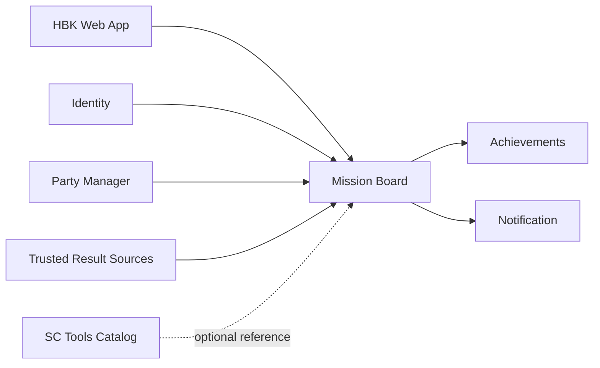

# Architecture And Business Ownership

## Context

## Ownership

| Context | Owns |
| --- | --- |
| Missions | Offers, contracts, confirmations, season merits, standings and winning placements |
| Identity | Users, memberships, tenant roles and tokens |
| Party Manager | Party lifecycle and live roster |
| Achievements | Achievement definitions, unlock records and profile presentation |
| Notification | Delivery preferences, inbox and channels |
| SC Tools | Read-only Star Citizen mission/catalog data |

## Modules

- `mission_board`: definitions, curated pools, rotations, offers, personalized eligibility and acceptance limits.
- `mission_contract`: roster snapshot, phases, objectives, evidence and result.
- `competition`: seasons, merit ledger, standings, corrections and awards.

Each module has its composition. The entrypoint adds modules and host concerns; it does not manually record its internal details.

## Interfaces And DI

External dependencies will be expressed as use case contracts, for example:

- get a party snapshot;
- list active definitions of a participant to personalize the board;
- publish an expired rotation from a curated pool;
- confirm a result source;
- persist a credit or adjustment;
- publish an awarded placement;
- consult a view of standings.

Concrete implementations are injected into composition. Domain and Application do not know about HTTP, AWS, databases, or clients of other services.

## Domain Model And Value Objects

The domain layer keeps business rules inside entities and value objects. Key value objects:

- `ConfirmationID` — the stable, composite identity for a confirmed objective unit (`contract:objective:unit:recipient`). It removes string concatenation and parsing from handlers.
- `ActiveContractSummary` — a lightweight, policy-ready value object for acceptance decisions.
- `MissionOffer` and `Season` use validating constructors (`NewValidMissionOffer`, `NewActiveSeason`) so the application layer does not duplicate domain rules.

`MissionContract.Confirm` owns the confirmation policy; the `ConfirmObjective` package function is a thin wrapper. `MissionContract.Summary` produces the acceptance-policy value object.

## Consistency

- Acceptance protects personal limit and offer capacity.
- Confirmation and credit use an idempotent identity.
- The ledger is the truth; standings are rebuildable.
- Status and reliable publishing are coordinated without mandatory synchronous calls.
- No global order of events is assumed.

## Observability

Measure available offers, rejections by limit, contracts by status, confirmations accepted/rejected, duplicates, merits by category, leaderboard delay, open disputes and pending awards. User/tenant IDs belong to traceable logs, not high cardinality dimensions.
